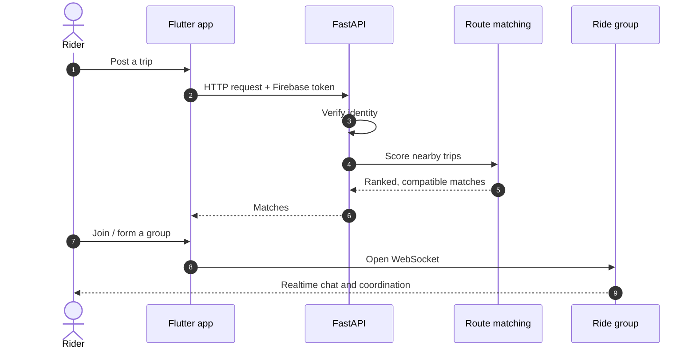
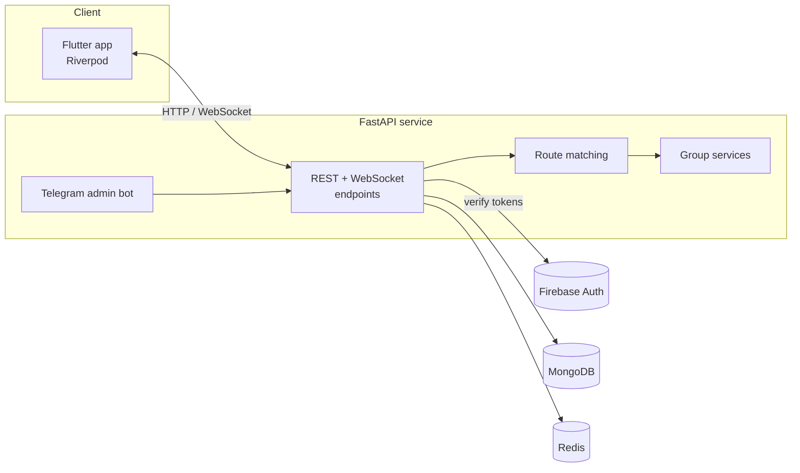

<a id="readme-top"></a>

<div align="center">


# Orix

**Find your way to campus, together.**

A campus ride-coordination app. Post a trip, get matched with riders on a compatible route, and chat with your group in real time.

<br />


<a href="LICENSE"></a>

<br />

[Features](#features) · [How it works](#how-it-works) · [Quick start](#quick-start) · [Configuration](#configuration) · [Architecture](#architecture) · [Testing](#testing) · [Troubleshooting](#troubleshooting)

</div>

<br />

<!--
  TODO: add a screenshot row here. It's the single biggest upgrade to this README.
  Suggested: 3 phone screenshots (Home, Match results, Group chat), each ~240px wide.

  <p align="center">
    
    
    
  </p>
-->

## Why Orix

Campus commutes are a coordination problem. Everyone is heading to the same few places at roughly the same times, but finding the people going your way means digging through group chats.

Orix replaces that with a short flow: **post a trip, see who's going your way, form a group, and talk.**

## Features

| | Feature | What it does |
|---|---|---|
| 🧭 | **Route matching** | Scores trips by geographic distance and a weighted compatibility function, so the best matches surface first. |
| 👥 | **Group formation** | Compatible riders are grouped by backend services that handle the coordination for you. |
| 💬 | **Realtime chat** | WebSocket endpoints give each ride group a live channel. |
| 🔐 | **Verified identity** | Firebase Admin validates client tokens on the server. |
| ⚡ | **Fast transient state** | Redis holds short-lived state. MongoDB holds the durable data. |
| 🤖 | **Telegram admin bot** | Operators can manage the service from Telegram. |

## How it works



> [!NOTE]
> Matching combines geographic distance with a weighted score. If you want contributors to tune it, document the weights and their defaults in a short `docs/matching.md` and link it here.

## Quick start

### Prerequisites

| Tool | Used for |
|---|---|
| Python 3.11+ | Backend (check `backend/requirements.txt` for exact constraints) |
| Flutter (stable channel) | Mobile client |
| MongoDB | Application data |
| Redis | Transient state |
| A Firebase project | Authentication (service account for the backend, app config for the client) |

<details>
<summary><b>Don't have MongoDB or Redis? Run both with Docker</b></summary>

<br />

```bash
docker run -d --name orix-mongo -p 27017:27017 mongo:8
docker run -d --name orix-redis -p 6379:6379 redis:8
```

</details>

### 1. Clone

```bash
git clone https://github.com/ChristopherJoshy/Orix.git
cd Orix
```

### 2. Start the backend

<details open>
<summary><b>Windows (PowerShell)</b></summary>

<br />

```powershell
cd backend
python -m venv .venv
.venv\Scripts\Activate.ps1
pip install -r requirements.txt
Copy-Item .env.example .env
uvicorn app.main:app --reload --host 0.0.0.0 --port 8000
```

</details>

<details>
<summary><b>macOS / Linux</b></summary>

<br />

```bash
cd backend
python -m venv .venv
source .venv/bin/activate
pip install -r requirements.txt
cp .env.example .env
uvicorn app.main:app --reload --host 0.0.0.0 --port 8000
```

</details>

Fill in `.env` first (see [Configuration](#configuration)). When the server is up, interactive API docs are at **http://localhost:8000/docs**.

### 3. Run the app

In a second terminal:

```bash
cd frontend
flutter pub get
flutter run
```

> [!TIP]
> Android emulators can't reach your computer through `localhost`. Use `10.0.2.2:8000` as the API host. On a physical device, use your computer's LAN IP and make sure both are on the same network.

## Configuration

All backend configuration lives in `backend/.env`. Start from the template, which lists every variable the app reads:

```bash
cp backend/.env.example backend/.env
```

| Area | What you need |
|---|---|
| **Firebase** | A service account for the backend to verify ID tokens, plus the Firebase config in the Flutter app |
| **MongoDB** | Connection string for your instance |
| **Redis** | Connection URL for your instance |
| **Telegram bot** | Bot token and admin identifiers (only if you run the admin bot) |
| **Maps** | Any map provider key referenced in `.env.example` |

> [!WARNING]
> Never commit `.env` or service-account files. Keep them in `.gitignore`.

## Architecture



### Stack

| Layer | Tools |
|---|---|
| Client | Flutter, Dart, Riverpod |
| API | Python, FastAPI, Pydantic |
| Persistence | MongoDB (Motor), Redis |
| Identity | Firebase Admin |
| Realtime / admin | WebSockets, python-telegram-bot |
| Tests | pytest, pytest-asyncio |

<details>
<summary><b>Repository layout</b></summary>

<br />

```text
Orix/
├── backend/     API, services, data models, tests, Telegram bot
└── frontend/    Flutter screens, features, providers, platform targets
```

</details>

## Testing

```bash
cd backend
pytest
```

## Troubleshooting

<details>
<summary><b>PowerShell blocks the venv activation script</b></summary>

<br />

Allow scripts for your user, then retry:

```powershell
Set-ExecutionPolicy -Scope CurrentUser -ExecutionPolicy RemoteSigned
```

</details>

<details>
<summary><b>The app can't reach the backend</b></summary>

<br />

- Confirm the server runs with `--host 0.0.0.0`.
- Android emulator: use `10.0.2.2`, not `localhost`.
- Physical device: use your computer's LAN IP, on the same network, and allow port 8000 through your firewall.

</details>

<details>
<summary><b><code>cd Orix</code> fails on Linux or macOS</b></summary>

<br />

Those filesystems are case-sensitive. The cloned folder is `Orix`, not `orix`.

</details>

## Contributing

Issues and pull requests are welcome.

1. Fork the repo and create a branch: `git checkout -b feat/your-idea`
2. Make your change and run `pytest` in `backend/`
3. Open a pull request describing what changed and why

## Project status and safety

> [!IMPORTANT]
> This repository contains application code, not a deployed ride service. Before connecting real users, review the environment configuration and the safety flows (identity checks, reporting, and admin tooling).

## License

Released under the [MIT License](LICENSE).

<br />

<div align="center">

<sub>Built for students who'd rather share the ride. · <a href="#readme-top">Back to top ↑</a></sub>


</div>
