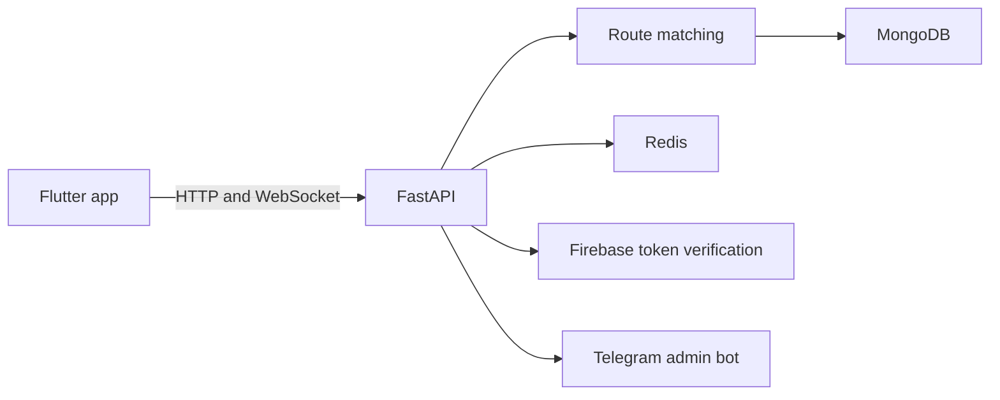

<div align="center">
  

  <p>
    
    
    
    <a href="LICENSE"></a>
  </p>
  
</div>

## 🚗 What it does

Orix is a campus ride-coordination app with a Flutter client and a FastAPI service. Riders can post trips, find compatible routes, form groups, and coordinate through realtime chat. The backend also includes a Telegram admin bot.

## 🧭 System map



## ✨ Features in the repository

- Route compatibility uses geographic distance calculations and a weighted scoring function.
- Group formation and ride coordination are handled by backend services.
- WebSocket endpoints support realtime group communication.
- Firebase Admin is used to validate client identity; MongoDB stores application data and Redis supports transient state.
- Flutter app code is organized by features and shared services.

## 🧰 Stack

| Layer | Tools |
|---|---|
| Client | Flutter, Dart, Riverpod |
| API | Python, FastAPI, Pydantic |
| Persistence | MongoDB (Motor), Redis |
| Identity | Firebase Admin |
| Realtime/admin | WebSockets, python-telegram-bot |
| Tests | pytest, pytest-asyncio |

## 🚀 Run locally

Backend:

```bash
git clone https://github.com/ChristopherJoshy/orix.git
cd orix/backend
python -m venv .venv
# Windows: .venv\Scripts\Activate.ps1
# macOS/Linux: source .venv/bin/activate
pip install -r requirements.txt
Copy-Item .env.example .env  # PowerShell; use cp on macOS/Linux
uvicorn app.main:app --reload --host 0.0.0.0 --port 8000
```

Mobile app, in another terminal:

```bash
cd orix/frontend
flutter pub get
flutter run
```

Configure Firebase, MongoDB, Redis, and any map or bot credentials required by the `.env.example`. The API's interactive docs are available at `/docs` while the backend is running.

## 🧪 Tests

```bash
cd backend
pytest
```

## 🗂️ Layout

```text
backend/   API, services, data models, tests, Telegram bot
frontend/  Flutter screens, features, providers, and platform targets
```

## 📄 License

MIT. See [`LICENSE`](LICENSE).

## ⚠️ Notes

This repository contains application code, not a deployed ride service. Review the environment configuration and safety flows before connecting real users.